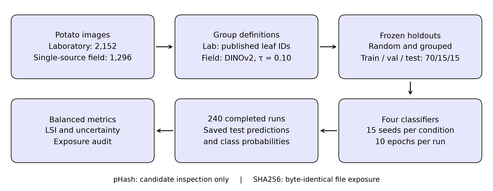
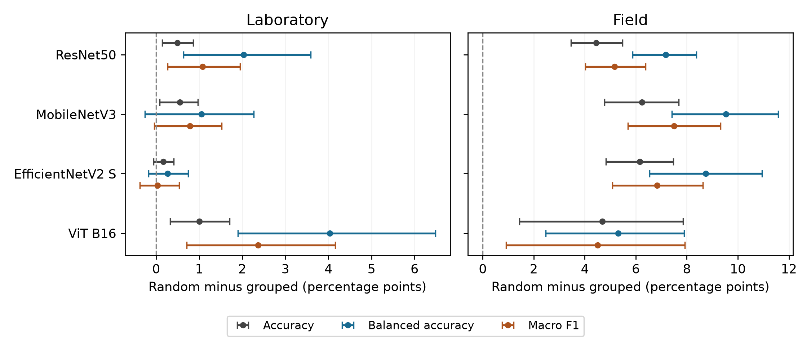

# Leaf Identity and Visual Group Splitting in Potato Disease Classification

Reproducibility materials for the corrected **v5 study** accepted by *Frontiers in Computer Science* on 9 October 2026. The package contains the recorded results, frozen evaluation partitions, executed training engine, analysis code, reference metadata and figure materials.

[Article at Frontiers](https://www.frontiersin.org/journals/computer-science/articles/10.3389/fcomp.2026.1946705/abstract) · Article DOI: `10.3389/fcomp.2026.1946705` · [Stable corrected repository version](https://github.com/Gonder301/potato_disease_paper/tree/corrected-v5)

**Authors:** Andrés Abraham Guerrero Jaramillo, Hugo Vega-Huerta, Gustavo Arredondo-Castillo, William Enriquez, Rubén Gil-Calvo, Juan Honorato Luna-Valdez, Antonio Mambret Luna Figueroa, Maria Laura Barrera Cajachagua, Juan Carlos Lázaro-Guillermo, Mario Chauca, Moisés Ronal Niño Cueva and Ivan Adrianzén-Olano.

## Recorded experiment

Four architectures × two datasets × two holdout strategies × 15 seeds = **240 completed runs**. Sixty laboratory random runs were reused unchanged from v4.2; 180 further runs completed the corrected plan. The archive contains **62,160 per-image predictions, 240 ten-epoch histories and 60 frozen partitions**. Full image datasets and final trained weights are not included.

| Dataset | Images and source classes | Grouped evaluation unit |
|---|---|---|
| Laboratory | 2,152 PlantVillage images: 152 Healthy, 1,000 Early blight, 1,000 Late blight | 538 published leaf identities, four images per identity |
| Single-source field | 1,296 images: 201 Healthy, 748 Fungi, 347 Phytophthora | DINOv2 visual clusters, average cosine linkage threshold 0.10 |

Classifiers are ResNet50, MobileNetV3 Large, EfficientNetV2 S and ViT B16. Training uses 10 epochs, batch size 32, AdamW learning rate 0.0003, weight decay 0.0001 and unweighted cross-entropy. The highest validation macro F1 selects the checkpoint evaluated on test. Frozen random and constrained grouped assignments target train/validation/test proportions of 70/15/15. These are repeated holdouts, not K-fold cross-validation.

## Recalculate the results on CPU

From a downloaded or cloned copy of this repository, using Python 3.12 or newer:

```bash
python -m pip install -r requirements-reanalysis.txt
python code/reanalyze.py --output reanalysis_output
```

The command checks file hashes, labels, probabilities, test IDs, partitions and histories, recomputes the metrics and statistical comparisons, and compares them with the published tables. No GPU, PyTorch or training is required. Expected output is `reanalysis_output/verification.json` with `status: PASS`. Use a new output directory for a repeated execution. A [CPU notebook](reanalysis.ipynb) provides the same procedure.

[Full reproduction and training instructions](docs/REPRODUCIBILITY.md) describe the recorded environment, image sources, Kaggle continuation, and limits on future training replication. [`experimentos.ipynb`](experimentos.ipynb) launches the preserved training engine on the frozen v5 partitions; the original notebook used to continue from 200 runs remains separately identified in `notebooks/`.

## Findings and limits

At threshold 0.10, laboratory DINOv2 clusters have pair precision **3.89%**, pair recall **49.91%** and identity purity **38.34%** against published leaf IDs. Visual similarity therefore cannot be treated as specimen identity. Laboratory random test exposure to training leaf identities averages **97.13%**, while identity-grouped holdout has zero such exposure.

Mean random-minus-grouped balanced accuracy gaps range from **0.27 to 4.03 percentage points** in laboratory and **5.31 to 9.54 points** in field. Seventeen of the 24 primary comparisons satisfy the specified Benjamini-Hochberg criterion, including all 12 field comparisons. None of the six exploratory ViT-versus-mean-CNN contrasts survives its separate adjustment.

These findings establish sensitivity to the evaluated partition protocols. They do not causally isolate duplicate effects or establish a general CNN/transformer robustness advantage. LSI is a descriptive relative split gap, not the fraction of accuracy caused by leakage. Field near-duplicate identity has **no human validation**, and the field threshold was not independently calibrated. The laboratory and field tasks have different categories, repeated test sets overlap, and uncertainty is conditional on these datasets. The corrected study was designed after examining earlier results and was not preregistered.

## Repository contents

| Location | Contents |
|---|---|
| [`results/results_closure_v5_final.zip`](results/results_closure_v5_final.zip) | Unmodified final archive: predictions, histories, completion records, frozen manifest and partitions, hashes, environments and log |
| [`analysis/`](analysis/) | Metrics by run and class, 24 primary tests, six exploratory interactions, exposure, allocations and original audit |
| [`code/`](code/) | Executed engine/runtime, original reanalysis adapter and new portable CPU, training-launch and plotting adapters |
| [`reference/`](reference/) | Pinned PlantVillage leaf map, full image-to-leaf mapping and historical v4.2 inputs needed for diagnostics |
| [`figures/`](figures/) | Four original figures, t-SNE coordinates and parameters, and sample provenance |
| [`samples/`](samples/) | Eight unchanged illustrative PlantVillage source images |
| [`provenance/`](provenance/) | Selected original preparation scripts and release verification record |
| [`historical/july-2026/`](historical/july-2026/) | Superseded July notebook, manuscript, README and aggregate results |

The original result archive SHA256 is:

```text
501c4214e73583c628e799659b7e3a69b7aeaab38af28706e374c85ac3d71874
```

`SHA256SUMS.json` records the hashes of all release files except itself. The executed training engine and runtime are preserved byte-for-byte. New adapters are identified in [provenance](docs/PROVENANCE.md). Pretrained-weight hashes and immutable download revisions were not recorded; saved predictions support exact metric reanalysis within the documented numeric tolerance, while future training is not guaranteed to be bitwise identical.

See [data and code availability](docs/DATA_AVAILABILITY.md) for the corrected availability statement and Q12 wording, and [data sources and attribution](DATA_SOURCES.md) for image and metadata provenance. No DOI has been assigned to this data package. The article DOI above is a separate identifier.

## Figures





The [embedding projection](figures/Figure_2_tsne.png) and [comparative source samples](figures/Figure_3_samples.png) are also included. Regenerate drawings from the deposited coordinates and samples using `code/render_figures.py`; this does not refit t-SNE. The sample panel illustrates published laboratory identities and is not new manual annotation of field duplicates.

## Historical material

The July version remains available under `historical/july-2026/` and at tag `historical-july-2026`. It used different source composition, grouping, training and interpretations. Its mixed-source field results and claims about architecture-specific leakage inflation do not define the corrected study. Use the corrected v5 results and instructions above for this article.
